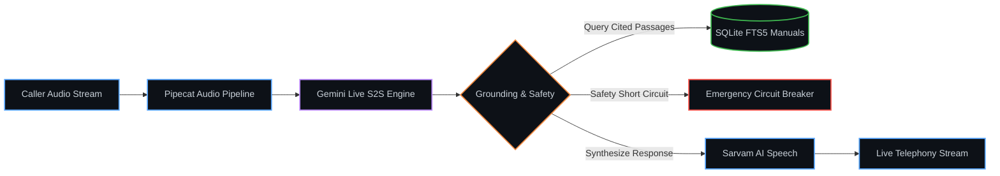

  

  

  

    
    
  

---

### 👨‍💻 About Me

I am a **Full Stack Engineer** and **AI Systems Builder** passionate about architecting resilient production software across autonomous agent architectures, edge native cloud systems, and low level hardware firmware.

▸ 🔭 **What I am building:** Multi agent autonomous offices, real time voice pipelines, and high concurrency cloud systems.  
▸ ⚡ **Engineering Breadth:** Edge computing with Cloudflare Workers and D1, full duplex voice agents (Pipecat, Sarvam, Gemini), and embedded C++ firmware for industrial printing.  
▸ 🔬 **Core Interests:** Agentic memory and coordination, verifiable execution proofs, and privacy preserving machine learning (Federated Learning).  
▸ 💬 **Ask me about:** Python, TypeScript, React, Cloudflare ecosystem, LiteLLM, Agent architectures, and bridging physical hardware with intelligent cloud workflows.

---

### 🛠️ Tech Stack & Tooling

  

 

<table>
  <tr>
    <td width="22%"><b>Languages</b></td>
    <td>Python, TypeScript, JavaScript, C++, C, SQL, Bash</td>
  </tr>
  <tr>
    <td width="22%"><b>AI &amp; Agents</b></td>
    <td>PyTorch, Gemini API, LiteLLM, Pipecat Voice AI, Hugging Face, Multi Agent Systems</td>
  </tr>
  <tr>
    <td width="22%"><b>Web &amp; Backend</b></td>
    <td>React, Node.js, FastAPI, Cloudflare Workers, Cloudflare D1, Tailwind CSS</td>
  </tr>
  <tr>
    <td width="22%"><b>Databases &amp; DevOps</b></td>
    <td>PostgreSQL, SQLite (FTS5), Redis, Docker, Git, GitHub Actions, Linux</td>
  </tr>
  <tr>
    <td width="22%"><b>Systems &amp; Hardware</b></td>
    <td>Embedded C++, Firmware Development, Hardware Integration, Distributed ML</td>
  </tr>
</table>

---

### 🔀 Architecture Pipeline: Real Time Voice Agent

---

### 🚀 Featured Projects &amp; Architectures

<table>
  <tr>
    <td width="50%" valign="top">
      <h3 align="center"><a href="https://github.com/shahmanager/voice-on-call-ai-agent">🎙️ Voice On-Call AI Agent (Shubh)</a></h3>
      
Production grade conversational voice agent runtime designed for live telephony and real time enterprise support.

      

        
        
        
        
      

      <ul>
        <li><b>Real Time S2S:</b> Full duplex Indian English and Hinglish streaming with Gemini Live S2S and Pipecat.</li>
        <li><b>Deterministic Safety and Grounding:</b> Model independent safety circuits plus SQLite FTS5 cited retrieval over product manuals.</li>
        <li><b>Telephony and State:</b> Real time audio streaming protocol and hybrid text checkpoints for session cycling.</li>
      </ul>
    </td>
    <td width="50%" valign="top">
      <h3 align="center"><a href="https://github.com/shahmanager/jarvis-meets-friday">🤖 Jarvis Meets Friday</a></h3>
      
Persistent two agent collaborative office environment with verified execution.

      

        
        
        
      

      <ul>
        <li>Cloud execution paired with owner reviewed laptop evidence collection.</li>
        <li>Persistent agent memory, inter agent messaging, and architectural roadmap.</li>
        <li>Verified task delivery with dual agent separation of concerns.</li>
      </ul>
    </td>
  </tr>
  <tr>
    <td width="50%" valign="top">
      <h3 align="center"><a href="https://github.com/shahmanager/frontier">⚡ Frontier</a></h3>
      
One shot build discipline and parallel safe multi agent leases for AI coding.

      

        
        
        
      

      <ul>
        <li>Guarantees correct context and SHA bound verifiable build proofs.</li>
        <li>Implements parallel safe leases for concurrent agent operations.</li>
        <li>Zero external dependencies: self contained in a single standard library file.</li>
      </ul>
    </td>
    <td width="50%" valign="top">
      <h3 align="center"><a href="https://github.com/shahmanager/federated-credit-risk">🔒 Federated Credit Risk</a></h3>
      
Privacy preserving ML across simulated banking nodes using FedAvg.

      

        
        
        
      

      <ul>
        <li>Simulates distributed financial institutions training risk models locally.</li>
        <li>Aggregates model weights centrally using Federated Averaging (FedAvg).</li>
        <li>Guarantees zero raw customer financial data is transmitted across network boundaries.</li>
      </ul>
    </td>
  </tr>
</table>

---

### 📊 GitHub Activity &amp; Telemetry

  
  
    
  
  <table border="0">
    <tr>
      <td>
        
      </td>
      <td>
        
      </td>
    </tr>
  </table>
  
   
  
  

 

  

