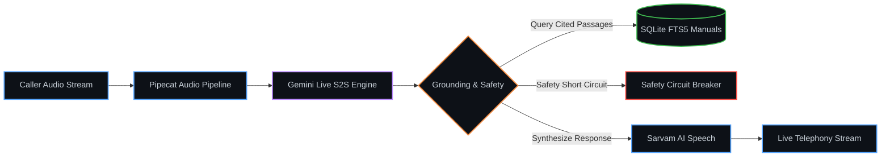

  

  

  

    
    
  

---

### 👨‍💻 About Me

Hi! I am a developer and builder passionate about AI systems, agentic workflows, and hands-on systems programming. I enjoy building functional projects from first principles, learning how complex systems work under the hood, and connecting high level AI models with practical applications and physical hardware.

▸ 🔭 **What I am working on:** Voice conversational agents, multi agent coordination setups, and full stack tools.  
▸ ⚡ **Areas of exploration:** Real time speech pipelines (Pipecat, Gemini Live S2S), edge computing with Cloudflare Workers, and embedded C++ firmware.  
▸ 🔬 **Curiosities:** How autonomous agents manage long term memory, privacy preserving distributed ML (Federated Learning), and writing clean, reliable code.  
▸ 💬 **Let's talk about:** Python, TypeScript, React, AI experiments, hardware tinkering, and building things that solve real problems.

---

### 🛠️ Tech Stack & Tooling

  

 

<table>
  <tr>
    <td width="22%"><b>Languages</b></td>
    <td>Python, TypeScript, JavaScript, C++, C, SQL, Bash</td>
  </tr>
  <tr>
    <td width="22%"><b>AI &amp; Frameworks</b></td>
    <td>PyTorch, Gemini API, LiteLLM, Pipecat Voice AI, Hugging Face</td>
  </tr>
  <tr>
    <td width="22%"><b>Web &amp; Backend</b></td>
    <td>React, Node.js, FastAPI, Cloudflare Workers, Cloudflare D1, Tailwind CSS</td>
  </tr>
  <tr>
    <td width="22%"><b>Tools &amp; Storage</b></td>
    <td>PostgreSQL, SQLite (FTS5), Redis, Docker, Git, GitHub Actions, Linux</td>
  </tr>
  <tr>
    <td width="22%"><b>Hardware &amp; Systems</b></td>
    <td>Embedded C++, Firmware Experiments, Hardware Interfacing</td>
  </tr>
</table>

---

### 🔀 Architecture Pipeline: Real Time Voice Agent

---

### 🚀 Projects &amp; Experiments

<table>
  <tr>
    <td width="50%" valign="top">
      <h3 align="center"><a href="https://github.com/shahmanager/voice-on-call-ai-agent">🎙️ Voice On-Call AI Agent (Shubh)</a></h3>
      
A voice agent exploring live speech to speech conversations with grounded knowledge retrieval.

      

        
        
        
        
      

      <ul>
        <li><b>Speech to Speech:</b> Conversational audio in Indian English and Hinglish using Gemini Live S2S and Pipecat.</li>
        <li><b>Grounded Answers:</b> Uses SQLite FTS5 text search over product manuals to cite passages instead of guessing.</li>
        <li><b>Safety Guardrails:</b> Simple keyword interceptors that prioritize user safety before triggering model calls.</li>
        <li><b>Telephony:</b> Streams live audio over WebSockets with state checkpointing between turns.</li>
      </ul>
    </td>
    <td width="50%" valign="top">
      <h3 align="center"><a href="https://github.com/shahmanager/jarvis-meets-friday">🤖 Jarvis Meets Friday</a></h3>
      
An experimental two agent setup exploring cloud execution, laptop verification, and memory.

      

        
        
        
      

      <ul>
        <li>Separates background cloud task execution from local laptop evidence review.</li>
        <li>Explores durable agent memory and structured messaging between collaborating agents.</li>
        <li>Focuses on clear progress logging and verifiable completion criteria.</li>
      </ul>
    </td>
  </tr>
  <tr>
    <td width="50%" valign="top">
      <h3 align="center"><a href="https://github.com/shahmanager/frontier">⚡ Frontier</a></h3>
      
A lightweight Python utility exploring multi agent file leases and SHA based build verification.

      

        
        
        
      

      <ul>
        <li>Built in a single standard library Python file with zero third party dependencies.</li>
        <li>Uses simple file leases to prevent race conditions during concurrent agent edits.</li>
        <li>Computes SHA hashes to ensure clean context boundaries and reproducible build steps.</li>
      </ul>
    </td>
    <td width="50%" valign="top">
      <h3 align="center"><a href="https://github.com/shahmanager/federated-credit-risk">🔒 Federated Credit Risk</a></h3>
      
A practical simulation of privacy preserving machine learning across banking nodes using FedAvg.

      

        
        
        
      

      <ul>
        <li>Simulates distributed financial institutions training local models on private client data.</li>
        <li>Aggregates model weights centrally via Federated Averaging without sharing raw records.</li>
        <li>Explores the balance between predictive performance and data privacy.</li>
      </ul>
    </td>
  </tr>
</table>

---

### 📊 GitHub Activity &amp; Telemetry

  
  
    
  
  <table border="0">
    <tr>
      <td>
        
      </td>
      <td>
        
      </td>
    </tr>
  </table>
  
   
  
  

 

  

